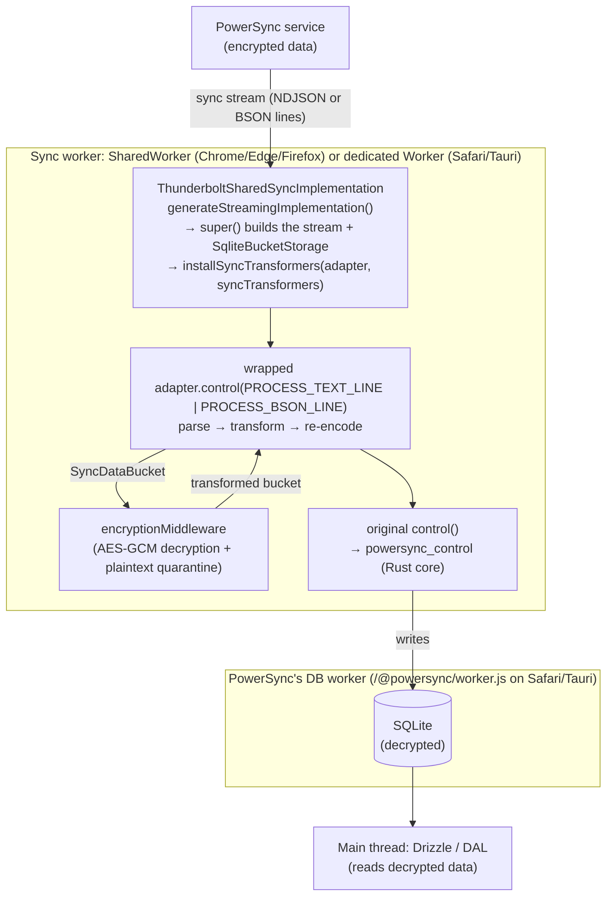

# PowerSync Sync Middleware & Custom Sync Worker

## Overview

PowerSync writes server data (PostgreSQL) into local SQLite as-is. The middleware intercepts sync data **before the write** to decode, normalize, or decrypt it. The only transformer today is AES-256-GCM decryption of encrypted columns ([e2e-encryption.md](e2e-encryption.md)), which also quarantines server-supplied plaintext in encrypted columns.

PowerSync has no supported hook for transforming downloaded data (see [powersync-js discussion #864](https://github.com/powersync-ja/powersync-js/discussions/864)). We wrap one method on the bucket-storage adapter PowerSync itself builds, and let upstream construct everything else.

---

## Architecture

### Key Files

| File                                                                                                                                                          | Role                                                                                                                    |
| ------------------------------------------------------------------------------------------------------------------------------------------------------------- | ----------------------------------------------------------------------------------------------------------------------- |
| [src/db/powersync/sync-transform.ts](../../../src/db/powersync/sync-transform.ts)                                                                             | `installSyncTransformers(adapter, transformers)` — wraps the adapter's `control()` to run the transformer pipeline      |
| [src/db/powersync/middleware/index.ts](../../../src/db/powersync/middleware/index.ts)                                                                         | `syncTransformers` — the one list of transformers every sync path runs                                                  |
| [src/db/powersync/middleware/EncryptionMiddleware.ts](../../../src/db/powersync/middleware/EncryptionMiddleware.ts)                                           | Decrypts every `__enc:`-prefixed string value in the sync stream using AES-256-GCM via the codec; quarantines plaintext |
| [src/db/powersync/worker/ThunderboltSharedSyncImplementation.ts](../../../src/db/powersync/worker/ThunderboltSharedSyncImplementation.ts)                     | Extends `SharedSyncImplementation`; wraps the adapter of the streaming implementation upstream builds                   |
| [src/db/powersync/worker/ThunderboltSharedSyncImplementation.worker.ts](../../../src/db/powersync/worker/ThunderboltSharedSyncImplementation.worker.ts)       | SharedWorker entry point (Chrome/Edge/Firefox); speaks PowerSync's `{ service, port }` handshake for the sync service   |
| [src/db/powersync/worker/ThunderboltDedicatedSyncImplementation.worker.ts](../../../src/db/powersync/worker/ThunderboltDedicatedSyncImplementation.worker.ts) | Dedicated-Worker entry point (Safari/Tauri); hosts the same class with `self` as the one Comlink endpoint               |
| [src/db/powersync/ThunderboltPowerSyncDatabase.ts](../../../src/db/powersync/ThunderboltPowerSyncDatabase.ts)                                                 | Extends `WebPowerSyncDatabase`; wraps the main-thread adapter, which carries sync when it runs in the tab               |
| [src/db/powersync/database.ts](../../../src/db/powersync/database.ts)                                                                                         | Database config; picks the SharedWorker (Chrome/Edge/Firefox) or the dedicated Worker (Safari/Tauri)                    |

---

## Data Flow

Both worker paths run the same `ThunderboltSharedSyncImplementation` off the main thread and end at decrypted data in SQLite. They differ only in worker hosting (SharedWorker vs dedicated Worker).



When `enableMultiTabs` resolves to false (PowerSync's default on Android/iOS user agents for the `default` config, and the IndexedDB fallback of the `safari-tauri` config), sync runs **in the tab** instead and uses the main-thread adapter from `ThunderboltPowerSyncDatabase.generateBucketStorageAdapter()`, wrapped the same way.

---

## How `installSyncTransformers` Works

PowerSync's Rust sync client feeds the storage adapter one line at a time:

```
adapter.control(PROCESS_TEXT_LINE, jsonPayload)   // NDJSON responses
adapter.control(PROCESS_BSON_LINE, bsonPayload)   // BSON responses (preferred by the client)
```

`installSyncTransformers` replaces `control` on that adapter instance with a wrapper that, for sync-data lines:

1. Parses the payload (JSON string or BSON `Uint8Array`) to extract the `SyncDataBucket`
2. Runs the transformer pipeline (each transformer receives the previous one's output)
3. Re-encodes in the **same format** as the original (JSON → JSON, BSON → BSON)
4. Calls the original `control()`, which applies the line in its own write transaction — so decryption never holds the write lock

Lines without bucket data (checkpoints, etc.) and all other control commands (START, STOP, …) pass through unchanged. A transformer error, or a sync line in a shape the wrapper can't parse, rejects the call: the line is never applied untransformed (that would persist ciphertext and skip the quarantine), and PowerSync retries the stream.

> **Why wrap instead of replace?** `SqliteBucketStorage` registers a `tablesUpdated` listener in its constructor. Swapping in a second instance would leak the discarded one's listener on every reconnect; wrapping keeps upstream's instance, listeners and lifecycle intact.

> **Why both formats?** The client's `Accept` header prefers BSON, so a BSON-capable server sends `Uint8Array` payloads via `PROCESS_BSON_LINE` rather than JSON strings via `PROCESS_TEXT_LINE`. Handling only one would skip transformation on the other.

### Middleware Interface

```typescript
type DataTransformMiddleware = {
  transform(bucket: SyncDataBucket): Promise<SyncDataBucket> | SyncDataBucket
}
```

Transformers get one `SyncDataBucket`; its `OplogEntry[]` (`bucket.data`) entries have:

- `object_type`: table name (e.g. `"tasks"`)
- `object_id`: row ID
- `data`: JSON string of the row (modify this to transform field values)
- `op`: one of `PUT`, `REMOVE`, `MOVE`, `CLEAR` (`OpTypeJSON` in the sync protocol, not SQL verbs)
- `checksum`: must be kept — the client sums per-op checksums against the checkpoint

---

## The Sync Worker

On Chrome/Edge/Firefox PowerSync launches a **SharedWorker** that shares one sync connection across tabs and deduplicates CRUD uploads. That worker builds its own `SqliteBucketStorage` inside `SharedSyncImplementation.generateStreamingImplementation()` and never sees anything configured on the main thread: Comlink cannot serialize transformer functions across the worker boundary, and there is no injection option.

`ThunderboltSharedSyncImplementation` overrides that one `protected` method, calls `super`, and wraps `sync.webOptions.adapter` (a public getter onto the options the stream reads from at `connect()` time). It copies none of upstream's credential, upload or checkpoint relay, so upstream fixes there apply to us unchanged.

`ThunderboltSharedSyncImplementation.worker.ts` mirrors the sync half of PowerSync's bundled `worker.ts`: each tab posts `{ service: 'sync', port }` on the SharedWorker's port, and the entry hands that inner port to `WorkerClient`. `database.ts` points the default config at it:

```typescript
sync: {
  worker: () =>
    new SharedWorker(
      new URL('./worker/ThunderboltSharedSyncImplementation.worker.ts', import.meta.url),
      { type: 'module', name: `shared-sync-${dbFilename}` },
    ),
}
```

Vite detects `new SharedWorker(new URL(...))` and bundles the worker as a separate ES module chunk.

### Why This Works

- Transformer **logic** is compiled into the worker bundle, so nothing needs serializing
- The content key (CK) is read from IndexedDB inside the worker, so no `postMessage`
- The SharedWorker still manages a single connection, preserving multi-tab efficiency

### Accessing PowerSync Internals

`SharedSyncImplementation` (`@internal`), `WorkerClient` and `SharedWorkerConnectionRequest` are not exported from `@powersync/web`, so a Vite alias and a matching TypeScript `paths` entry point at the compiled `lib/` output. The adapter types and `PowerSyncControlCommand` come from `@powersync/shared-internals`, a direct dependency pinned to the exact version `@powersync/web` pins.

**`vite.config.ts`:**

```typescript
resolve: {
  alias: {
    'powersync-web-internal': path.resolve(__dirname, 'node_modules/@powersync/web/lib'),
  }
}
```

**`tsconfig.json`:**

```json
"paths": {
  "powersync-web-internal/*": ["./node_modules/@powersync/web/lib/*"]
}
```

```typescript
import { SharedSyncImplementation } from 'powersync-web-internal/worker/sync/SharedSyncImplementation.js'
```

> **Upgrade note**: when upgrading `@powersync/web`, check in `node_modules/@powersync/web/src/`:
>
> - `worker/sync/SharedSyncImplementation.ts`: `generateStreamingImplementation()` is still `protected`, still passes its bucket storage as `adapter`, and is still what `connect()` uses to build the stream.
> - `db/sync/WebStreamingSyncImplementation.ts`: `webOptions` still exposes that options object.
> - `worker/worker.ts`: the shared worker still uses the `{ service, port }` handshake.
> - `db/PowerSyncDatabase.ts`: `WebPowerSyncDatabase` (`@internal`) still exists and its base still calls `protected generateBucketStorageAdapter()` (in `@powersync/shared-internals`' `BasePowerSyncDatabase`).
> - `@powersync/shared-internals` (runtime enum + types, and the types-only `internal/sync_protocol` subpath) is pinned to the exact version `@powersync/web` pins, one copy in `bun.lock`. `@journeyapps/wa-sqlite` is not a direct dependency; it comes only through `@powersync/web`.
> - The FTS triggers in `src/search/fts-setup.ts` still match PowerSync's internal tables (`ps_data__*` names and the JSON `data` layout): after a fresh sync, the search index fills.
>
> Both hooks are declared `override`, so a renamed one fails to compile. `ThunderboltSharedSyncImplementation.test.ts` and `ThunderboltPowerSyncDatabase.test.ts` fail if a hook stops wrapping the adapter it builds; neither proves upstream still calls the hook.

---

## Local Storage

Both configs store the database on OPFS (`OPFSCoopSyncVFS`, chosen by `shouldUseOpfs` in `src/db/powersync/database.ts`), which is faster than IndexedDB. Two cases keep `IDBBatchAtomicVFS`:

- **No usable OPFS** (WebKitGTK on Tauri Linux, Firefox private browsing).
- **A `default`-config device whose data already lives in IndexedDB.** Switching would start from an empty database and lose local-only rows (secrets, MCP servers) and queued uploads, so it moves at its next reset instead: after the wipe, `resetAppDir` leaves an empty OPFS database file, which the next start takes as the signal to use OPFS, and deletes the IndexedDB database. Another tab holding that database open delays the delete; a later OPFS start retries it. Browsers that can't list their IndexedDB databases (Firefox before 126) stay on IndexedDB.

Sync telemetry reports the VFS as `ps_vfs`.

---

## Safari / Tauri: Why It Stays Different

Only the worker _hosting_ differs, not the transform. A SharedWorker is ruled out:

- **Tauri** (`tauri://`) blocks SharedWorker and `import.meta.url`-based worker loading for `node_modules` workers, so the DB worker loads PowerSync's prebuilt worker from an absolute path (`/@powersync/worker.js`, copied from `@powersync/web/dist/worker` by the `copy-powersync-assets` Vite plugin)
- SharedWorker exceeds iOS WKWebView memory limits and causes black-screen crashes

So the config sets `database.enableMultiTabs: true`, which selects `SharedWebStreamingSyncImplementation` (sync driven over Comlink, off the main thread), and keeps both workers dedicated:

- `database.worker` — the URL `/@powersync/worker.js`. It must be a URL, not a factory: PowerSync posts the database options to the sync worker over Comlink, and a function in them fails to clone, so sync never initializes. With a URL, PowerSync opens OPFS in a dedicated worker but the IndexedDB fallback in a SharedWorker whenever `enableMultiTabs` is on — so the fallback (no OPFS, e.g. WebKitGTK) sets `enableMultiTabs: false` and syncs in the tab, through the main-thread adapter `ThunderboltPowerSyncDatabase` wraps.
- `sync.worker` — `createDedicatedSyncWorker()`. PowerSync uses a dedicated Worker directly as its Comlink endpoint and terminates it on dispose; the factory's declared return type is `SharedWorker`, hence a cast. It hosts the same `ThunderboltSharedSyncImplementation`, so with OPFS the transform runs off the main thread.

---

## Adding Encrypted Columns

Add the table and column to `encryptedColumnsMap` in [src/db/encryption/config.ts](../../../src/db/encryption/config.ts). That map is the **upload** side's source of truth: `encodeForUpload` ([src/db/encryption/upload-encoder.ts](../../../src/db/encryption/upload-encoder.ts)), called from the connector, encrypts exactly those columns.

Download needs no entry. `encryptionMiddleware` decrypts any `__enc:`-prefixed string whatever column it came from, so a stale client whose bundled map predates the column still reads the row instead of storing ciphertext. Details: [e2e-encryption.md](e2e-encryption.md#adding-a-new-encrypted-column).

## Adding a Non-Encryption Transformer

For a non-encryption transform (normalization, decompression):

1. Create a file in `src/db/powersync/middleware/` implementing `DataTransformMiddleware`.
2. Add it to `syncTransformers` in [src/db/powersync/middleware/index.ts](../../../src/db/powersync/middleware/index.ts). Both the sync worker and sync in the tab read that one list.

---

## CK Access in the Sync Worker

Both worker types have direct `indexedDB` access, so the codec loads the content key (CK) lazily without `postMessage`, cached in a module-scoped variable for the worker's lifetime.

`invalidateCKCache()` posts to a `BroadcastChannel` (`thunderbolt-ck-invalidation`) so the main thread, sync worker, and other tabs drop a stale CK immediately. `resetCodecState()` does the same for sign-out/wipe and also clears the setup flag.

Full encryption architecture: [e2e-encryption.md](e2e-encryption.md).
