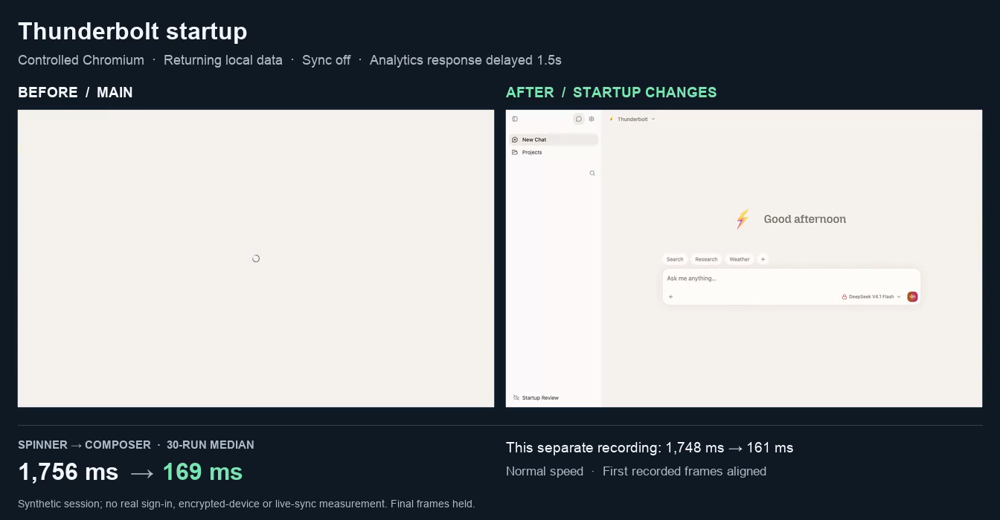

# Startup performance review — 2026-10-21

The reviewed change reduces median spinner-to-visible-composer time by **31.8% on returning local profiles** and **46.9% on fresh local profiles** in this controlled Chromium benchmark. With an explicitly injected 1,500 ms analytics-response delay, the reduction is **90.4%**: analytics no longer gates the main content. Initial JavaScript is **9.0% smaller raw / 8.8% smaller gzip**.

These measurements do not establish an 80% improvement across production launches, real sign-in, encrypted new-device setup, native WebViews, or multi-device sync.

## Before and after video

[Watch the side-by-side recording](startup-comparison.mp4)

[](startup-comparison.mp4)

The video shows actual separate browser captures at normal speed, with a **1.5-second injected analytics delay in both builds**. The first recorded frames are aligned; the recording does not provide an exact navigation-to-video clock mapping. Recordings are illustrative samples, excluded from the timing distributions. The before recording measured 1,748 ms spinner-to-composer; the after recording measured 161 ms. The displayed aggregate is the 30-run median, not a timing inferred from video frames.

## Measurements

Before is main at `ee419dfedf6435ba2e7438ad408d73d4f7a728ed`; after is this PR's reviewed implementation on that same base. Both production builds use the same locked dependencies and `VITE_SKIP_ONBOARDING=true`.

| Condition                                            | Samples per build | Median spinner → composer | Reduction | p90 spinner → composer | Median navigation → composer |
| ---------------------------------------------------- | ----------------: | ------------------------: | --------: | ---------------------: | ---------------------------: |
| Returning profile, immediate analytics               |                30 |        247.71 → 169.02 ms |     31.8% |     275.87 → 190.62 ms |           397.89 → 305.40 ms |
| Returning profile, injected 1,500 ms analytics delay |                30 |      1,755.77 → 168.75 ms |     90.4% |   1,770.04 → 177.58 ms |         1,904.10 → 304.62 ms |
| Fresh isolated profile, immediate analytics          |                10 |        354.03 → 188.16 ms |     46.9% |     360.71 → 197.27 ms |           501.36 → 319.06 ms |

Navigation-to-composer improves by 23.2%, 84.0%, and 36.4%, respectively. Reporting this alongside spinner time avoids attributing a later spinner appearance to faster overall startup. Percentages are duration reductions, calculated as `1 − after / before`.

| Initial static JavaScript graph |    Before |     After |          Saved |
| ------------------------------- | --------: | --------: | -------------: |
| Raw bytes                       | 2,228,322 | 2,027,396 | 200,926 (9.0%) |
| Gzip bytes                      |   682,748 |   622,501 |  60,247 (8.8%) |

The graph includes the entry and its static JS imports, excluding dynamic chunks, CSS, fonts, WASM and later requests. Both builds currently emit one JS file in this graph. Gzip is measured locally, not actual transferred bytes; the local server does not simulate a constrained network. A separate build with only the onboarding name/location split removed adds 59,875 raw / 20,118 gzip bytes, supporting that split's benefit.

## Method and limits

- Headless Chromium 148.0.7778.96 on macOS 26.7; 1280 × 800 viewport; no explicit CPU or network throttling. Both builds use the same local origin and machine. This is one machine/session, not a population estimate.
- Synthetic cached signed-in session, sync disabled, no device encryption keys, empty `/config`, empty analytics configuration. Analytics returns no API key, so this tests its configuration wait rather than SDK loading or live capture. All other API requests receive a synthetic 503. No real accounts, providers or messages are involved. Fresh profiles have empty local storage/database before the fixture is installed; they **do not exercise real authentication or onboarding**.
- HTTP cache disabled by Playwright routing and `Cache-Control: no-store`; service workers blocked. Returning runs reuse one isolated context per build and its local database, but close the page between samples. Fresh runs use a new context per sample. OS file caches and the Chromium process are warm, so these are not cold-process launches.
- Two warmups per returning condition, then alternating before/after order and delay order over 30 rounds. Fresh profiles alternate build order over 10 rounds. Only one app page is active at a time. Every run waits for analytics settlement before the next run, including the optimized build.
- Readiness requires an enabled, visible, hit-testable textarea and model selector, no visible dialog, and confirmation on the next animation frame. The reported timestamp is the first of those two frames. These are DOM rendering opportunities, not compositor presentation timestamps or proof that sending a message succeeds.
- All 154 recorded runs succeeded with no page exceptions, visible dialogs or missing spinner observations. That total includes 8 ordinary warmups, 4 video warmups and 2 video samples; only 140 samples contribute to the distributions. p90 uses linear interpolation.

[Raw sample timings](samples.csv) include warmups and video rows explicitly marked by phase. [Results and environment](results.json) retain distributions and input build hashes. The [recorder](benchmark.mjs) preserves the measured fixture and readiness rules.

## Review and validation

The review retained the existing session-binding, encryption and initial-sync gates. It removed a late-binding deferral and a sidebar-webview split whose risk outweighed the benefit. It also fixed first-use project search after deferred index setup, index retry/revalidation, delayed analytics consent handling, obsolete initialization timing, and native route preloading from non-chat entry points.

Regression coverage includes deferred analytics completion/failure/unmount/retry, consent changes during loading and first-sync consent, search setup from both palette and project tools, setup failure/retry and missing-trigger repair, shared watcher cleanup/schema invalidation, new/existing chat hydration, and initialization timing across retry.

- Frontend: **6,474 pass, 1 pre-existing failure** across 527 files.
- Shared/script suites: **541 pass** across 24 files; database diagnostics: **3 pass**.
- The sole failure is `src/search/query-plan.test.ts` → `keeps digits on the MATCH side` (`100%の確率` tokenization). It reproduces on the exact unchanged main revision with the same Bun/ICU environment; its source and test are unchanged by this PR.
- Production builds and frontend/E2E TypeScript checks pass. Changed-source lint has no errors.

The synthetic benchmark and unit suites do not replace native cold-launch or encrypted multi-device end-to-end testing. Those paths should be measured before making a broad production percentage claim.

## Reproduce

Build main at the revision above and this branch into separate directories using the same environment and locked dependencies:

```sh
VITE_SKIP_ONBOARDING=true bun run build --outDir /tmp/thunderbolt-review-before
# Run the equivalent command from the reviewed branch:
VITE_SKIP_ONBOARDING=true bun run build --outDir /tmp/thunderbolt-review-after
```

From the reviewed checkout, with Playwright Chromium installed and port 1431 free:

```sh
node docs/internals/performance/startup-2026-10-21/benchmark.mjs --execute \
  --before /tmp/thunderbolt-review-before \
  --after /tmp/thunderbolt-review-after \
  --out /tmp/thunderbolt-startup-new-run
```

The output directory must be new and under `/tmp`. It contains all raw events, distributions, screenshots and two original WebM captures. The runner intercepts service traffic and does not attach to an existing browser profile. Use the same build environment for both inputs; build hashes change if environment-derived configuration differs.
